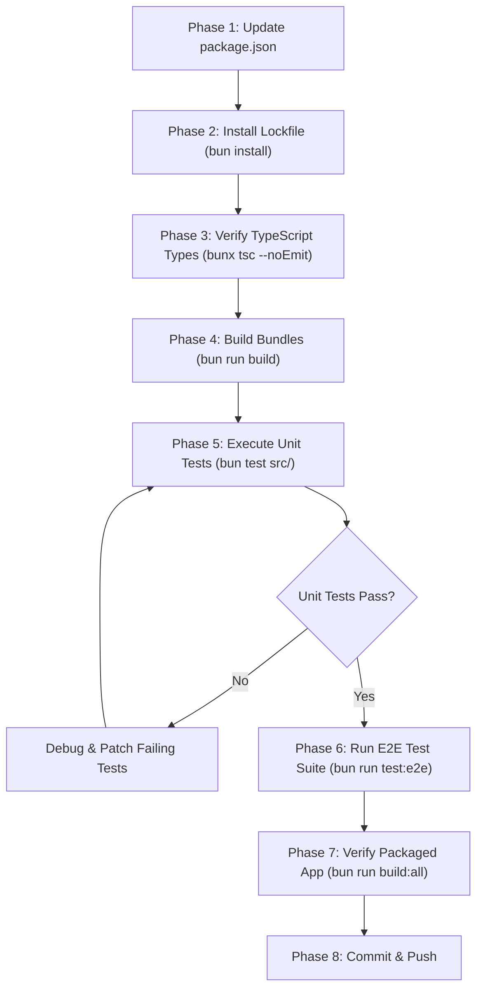

# UltraGIT - Package Upgrade Plan to Latest Stable

This document outlines the step-by-step strategy, dependency inventory, breaking changes, and validation matrix for upgrading all packages in **UltraGIT** to their latest stable releases.

---

## 1. Executive Summary & Inventory

The table below contrasts the baseline versions with their target stable versions:

| Package | Baseline Version | Target Stable Version | Release Type | Notes & Breaking Change Risk |
| :--- | :--- | :--- | :--- | :--- |
| **`electron`** | `^44.4.5` | **`^45.0.0`** | Major | Preload shim removals (no `events`/`timers`/`url` shims in sandboxed preloads); `nodeIntegrationInWorker` frame-level inheritance; screen-capture permissions moved to `'display-capture'`. |
| **`electron-vite`** | `^5.0.0` | **`^6.0.0`** | Major | Native Vite 6+ peer-dependency alignment; single-pass bytecode compiler refactoring; Node `>=20.19` / `>=22.12` engine requirement. |
| **`vite`** | `^8.3.1` | **`^8.3.5`** | Patch | Safe bugfix & performance update. |
| **`typescript`** | `^7.0.2` | **`^7.0.2`** | Current | Already on latest TypeScript 7.x release. |
| **`simple-git`** | `^4.0.2` | **`^4.0.2`** | Current | Already on latest 4.x release; environment guard configured via `allowEnvironment`. |
| **`react`** | `^19.3.0` | **`^19.3.1`** | Patch | Targeted RSC transport protocol performance update. |
| **`react-dom`** | `^19.3.0` | **`^19.3.1`** | Patch | Matches React 19.3.1. |
| **`zustand`** | `^5.0.15` | **`^5.0.16`** | Patch | Bugfixes in devtoolsreviver and removal of redundant `getServerSnapshot` memoization. |
| **`lucide-react`** | `^1.48.0` | **`^1.61.0`** | Minor | Additional icons added. Custom brand icons already decoupled to `BrandIcons.tsx`. |
| **`dompurify`** | `^3.4.16` | **`^3.4.17`** | Patch | Security hardening around `IN_PLACE`, shadow roots, and XHTML attribute guards. |
| **`marked`** | `^18.0.14` | **`^18.1.1`** | Minor | Bugfixes in blockquote lazy lines, code span emphasis, and tag name matching. |
| **`@playwright/test`** | `^1.63.0` | **`^1.64.1`** | Minor | Browser harness and trace viewer updates. |
| **`@types/bun`** | `^1.4.2` | **`^1.4.3`** | Patch | Updated type definitions for Bun 1.4+. |
| **`@types/react`** | `^19.3.0` | **`^19.3.0`** | Current | Up to date. |
| **`@types/react-dom`**| `^19.3.0` | **`^19.3.0`** | Current | Up to date. |
| **`@types/prismjs`** | `^1.26.6` | **`^1.26.6`** | Current | Up to date. |
| **`prismjs`** | `^1.30.0` | **`^1.30.0`** | Current | Up to date. |
| **`electron-builder`**| `^26.15.3` | **`^26.15.3`** | Current | Current stable production packager. |
| **`@vitejs/plugin-react-swc`** | `^4.3.3` | **`^4.3.3`** | Current | Up to date. |

---

## 2. Breaking Changes & Potential Failure Points

### A. Electron 45 (`44.4.5` → `45.0.0`)
1. **Sandboxed Preload Script Isolation**:
   - `events`, `timers`, and `url` Node.js shims are no longer provided via `require()` in sandboxed preload scripts.
   - `Buffer`, `setImmediate`, and `clearImmediate` are no longer injected into globals.
   - **Impact on UltraGIT**: `src/preload/index.ts` only imports `{ contextBridge, ipcRenderer }` from `'electron'` and `{ electronAPI }` from `'@electron-toolkit/preload'`, using standard `window` APIs. Preload should continue functioning cleanly.
2. **Display Capture Permission**:
   - If screen recording or window capture permissions are requested, permission handlers in `src/main/` must recognize `'display-capture'` rather than `'media'`.

### B. electron-vite 6 (`5.0.0` → `6.0.0`)
1. **Bytecode Compilation Changes**:
   - Bytecode compiler invocation is executed in a single pass.
   - Requires Node `>=20.19` or `>=22.12` / Bun runtime modern JS features.
2. **Config Schema**:
   - Verify `electron.vite.config.ts` still builds the three targets (main, preload, renderer) without deprecated rollup options.

### C. Marked (`18.0.14` → `18.1.1`) & DOMPurify (`3.4.16` → `3.4.17`)
1. **Markdown Parsing & Sanitization Tests**:
   - `marked@18.1.x` fixed blockquote termination and tag name matching (`pre`, `script`, `style`, `textarea`).
   - `DOMPurify@3.4.17` tightened parsing in `IN_PLACE` and literal-text elements.
   - **Impact**: Any unit test expecting exact HTML string output from markdown descriptions (e.g. `src/renderer/src/components/details/MarkdownDiffView.tsx`) might observe slight whitespace or tag-closing differences.

### D. simple-git v4 (`allowEnvironment`)
- Note: Already upgraded to `4.0.2`, but if new Git environment variables are introduced in any test or subshell command, ensure they are registered in:
  - `src/main/git.ts` (`allowedGitEnvs`)
  - `e2e/helpers/git-sandbox.ts` (`allowEnvironment`)

---

## 3. Phased Execution Plan



### Phase 1: Update Dependency Definitions
Update `package.json` with the target versions:
```json
{
  "devDependencies": {
    "@electron-toolkit/preload": "^3.0.2",
    "@electron-toolkit/utils": "^4.0.0",
    "@playwright/test": "^1.64.1",
    "@types/bun": "^1.4.3",
    "@types/dompurify": "^3.2.0",
    "@types/prismjs": "^1.26.6",
    "@types/react": "^19.3.0",
    "@types/react-dom": "^19.3.0",
    "@vitejs/plugin-react-swc": "^4.3.3",
    "electron": "^45.0.0",
    "electron-builder": "^26.15.3",
    "electron-vite": "^6.0.0",
    "typescript": "^7.0.2",
    "vite": "^8.3.5"
  },
  "dependencies": {
    "dompurify": "^3.4.17",
    "lucide-react": "^1.61.0",
    "marked": "^18.1.1",
    "prismjs": "^1.30.0",
    "react": "^19.3.1",
    "react-dom": "^19.3.1",
    "simple-git": "^4.0.2",
    "zustand": "^5.0.16"
  }
}
```

### Phase 2: Lockfile Refresh
Run the install command from the project root (`C:\DEV\ultra-git`):
```bash
bun install
```

### Phase 3: Type Checking
Validate all TypeScript typings across main, preload, renderer, and test folders:
```bash
bunx tsc --noEmit
```

### Phase 4: Production Build
Verify `electron-vite build` completes for main, preload, and renderer packages:
```bash
bun run build
```

### Phase 5: Unit Test Suite
Execute the 202 unit tests:
```bash
bun test src/
```

### Phase 6: Targeted E2E Test Verification
Run critical path Playwright integration suites:
```bash
# Active changes & staging
bunx playwright test e2e/active-changes.spec.ts

# Worktrees
bunx playwright test e2e/worktree.spec.ts

# Tag creation & sorting
bunx playwright test e2e/tag-creation.spec.ts

# Full E2E suite
bun run test:e2e
```

### Phase 7: App Packaging Smoke Test
Verify that `electron-builder` packages the application executable without ASAR or native module linking errors:
```bash
bun run build:all
```

---

## 4. Rollback Strategy
If any upgraded dependency causes unresolved regressions in the packaging step or CI pipeline:
1. Revert `electron` back to `^44.4.5` and `electron-vite` back to `^5.0.0`.
2. Run `bun install` to restore `bun.lock`.
3. Confirm with `bun run build && bun test src/`.
